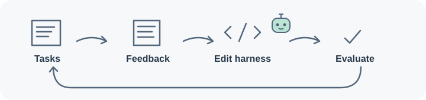
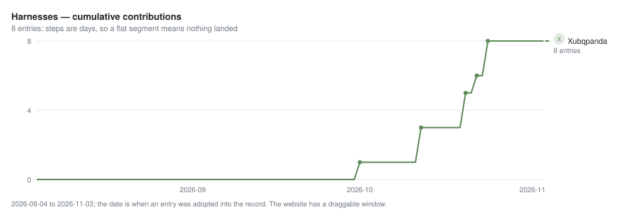
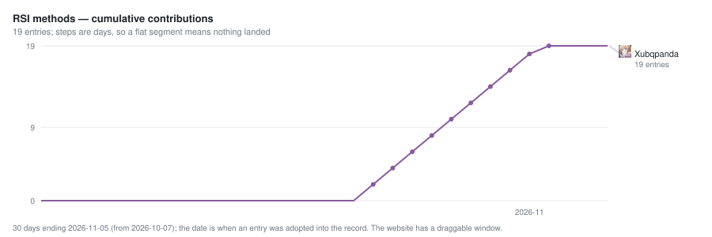
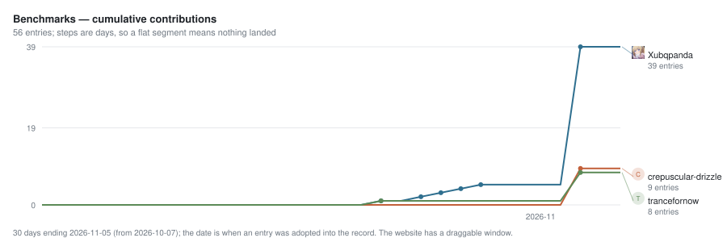
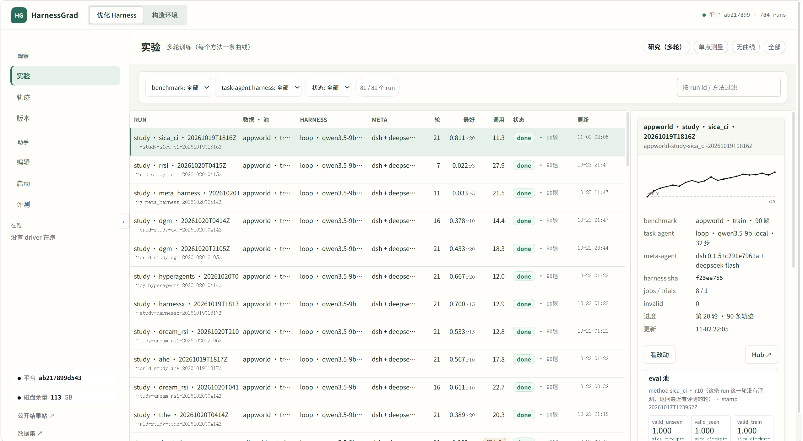
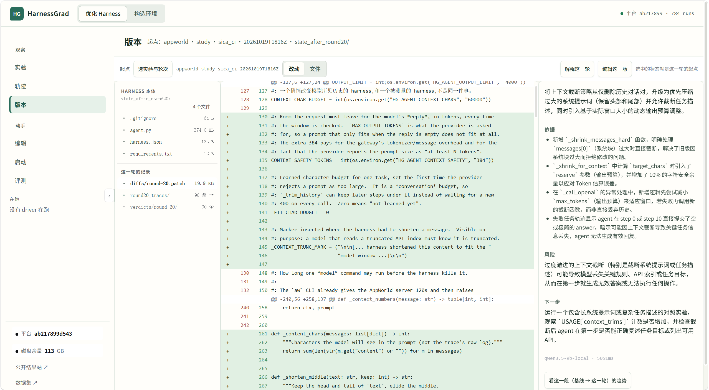
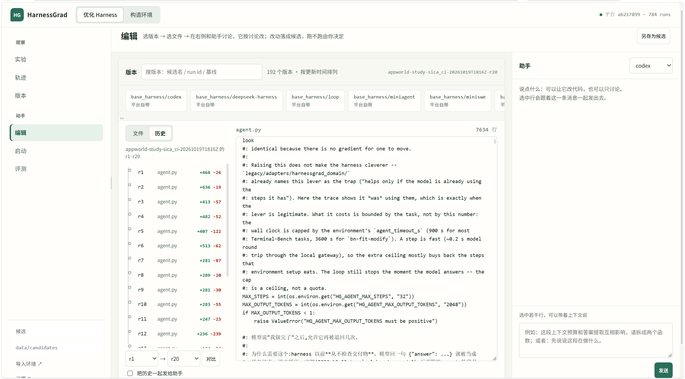
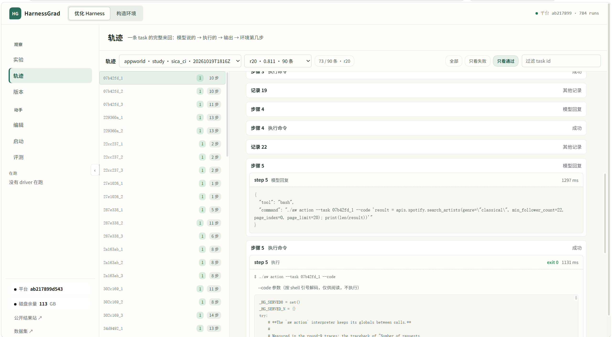

<p align="center">
  
</p>

<h1 align="center">HarnessGrad: Harness as A Continual Learner</h1>

<p align="center">An agent combines a model and a harness in an environment;<br>HarnessGrad studies how an editable harness can learn from feedback.</p>

<p align="center">🚀 <a href="#quick-start">Quick start</a> · 🧩 <a href="#what-you-can-run">Integrations</a> · 📚 <a href="DATASETS.md">Datasets</a> · 🔗 <a href="#related-work">Related work</a></p>

<p align="center"></p>

<p align="center">
  <a href="https://zjunlp.github.io/HarnessGrad/"></a>
  <a href="LICENSE"></a>
  
  
  <a href="https://github.com/zjunlp/HarnessGrad/actions/workflows/quality.yml"></a>
</p>

<a id="what-you-can-run"></a>

## 🧩 What you can run

A run is one point in a **harness × method × benchmark** space: a *harness* solves tasks, a
*method* proposes edits to that harness between rounds, and a *benchmark* scores each
candidate. HarnessGrad provides tasks and scoring, isolated execution, and version control
for candidate harnesses, with a recorded curve for each experiment.

<details>
<summary>Full harness, method and benchmark inventory</summary>

The table records the inventory at this README revision; the benchmark row is checked against the declared adapters.

| axis | what ships | where |
| --- | --- | --- |
| **harnesses** | 8: `loop`, `codex`, `opencode`, `deepseek-harness`, `openclaw`, `miniagent`, `miniswe`, `oracle` | `base_harness/<name>/` |
| **RSI methods** | 19: `dgm`, `rrsi`, `adas`, `ahe`, `ace`, `skillopt`, `evoprompt`, `evo_harness`, `opro`, `tthe`, `dream_rsi`, `sica_ci`, `gepa`, `darwinx`, `arbor`, `hyperagents`, `meta_harness`, `harnessx`, `modular_rsi` | `experiments/method-<name>.json` |
| **benchmarks** | 56 declared adapters; preparation and runtime prerequisites vary — every one listed: `agentdojo`, `aime`, `alfworld`, `appworld`, `authored_example_fix_bug`, `bbeh`, `bfcl_v3`, `bird_minidev`, `browsecomp`, `chessbench_puzzles`, `cooperbench`, `costbench`, `costbench_dynamic`, `deepsearchqa`, `deepswe`, `ds1000`, `fever`, `gaia`, `gsm8k`, `harvey_lab`, `hle`, `hotpotqa`, `jericho`, `jobbench`, `kumo`, `livecodebench`, `livemathbench`, `locomo`, `math`, `math500`, `memoryagentbench`, `musique`, `nq`, `officeqa_pro`, `personamem_v2`, `physicsquestions`, `reasoning_gym`, `scienceworld`, `searchqa`, `sportsunderstanding`, `spreadsheetbench`, `spreadsheetbench2`, `strategyqa`, `strongreject`, `supergpqa`, `swe_bench`, `swe_bench_pro`, `tau2_bench`, `tau3_bench`, `tau_bench`, `terminal_bench`, `travelplanner`, `triviaqa`, `twowikimultihopqa`, `widesearch`, `workbench` | `data/datasets/`, detail in [`DATASETS.md`](DATASETS.md) |

</details>

### Where to start

- **Bring a harness:** supply a directory with `harness.json` and an entrypoint accepting `--task` and `--workdir`. See [bring your own harness](docs/bring-your-own-harness.md).
- **Bring a method:** supply a program that reads a trajectory and writes a candidate tree. See [bring your own method](docs/bring-your-own-method.md).
- **Bring a benchmark:** write an adapter that materialises tasks and runs its official scorer. See [dataset onboarding](docs/dataset-onboarding.md).

<a id="why-one-command-is-enough"></a>

## ⚙️ Why one command is enough

A harness supplies `harness.json` and an entrypoint accepting `--task` and `--workdir` ([interface](INTERFACE.md)). The platform runs dataset tasks and scoring, isolates execution, versions candidate harnesses, and records each run's outcomes and receipts. Dataset and harness prerequisites still need to be installed separately.

<a id="why-the-comparison-is-fair"></a>

## ⚖️ Why the comparison is fair

Each round records the candidate harness hash and its changes, alongside the run's model roles and measurement metadata. Compare results only when their task selection, scorer, models and other relevant conditions support it. Failed or incomplete measurements are not scores, and unsupported measurements must not be replaced with proxy scores under the benchmark's name. See the [measurement policy](docs/refusal-policy.md).

<a id="installation"></a>

## 📦 Installation

Linux with Python **3.12+**, git, [uv](https://docs.astral.sh/uv/getting-started/installation/),
and a working `bubblewrap`. Keep the virtual environment
outside the checkout and outside `/tmp`, so the sandbox can mount its runtime without exposing
your platform or task files. The base Python installation must also stay outside those
directories. Interpreter links used by tools such as uv are preserved inside the sandbox;
only the required runtime directories are mounted, read-only.

```bash
git clone https://github.com/zjunlp/HarnessGrad.git
cd HarnessGrad
uv venv --seed --python 3.12 ~/.venvs/harnessgrad
source ~/.venvs/harnessgrad/bin/activate
uv pip install -e .
./install.sh --check
```

`--seed` installs pip into the environment, which harness configuration tools need for
host dependency overlays; `uv pip install` alone does not seed pip. Seeding may download
pip if it is not already cached, so an offline setup requires an appropriate pre-populated
uv cache. Creating the environment or installing the project may also require downloading
Python or build tools if they are not already available locally.

The platform itself has **no third-party runtime dependencies** and imports only the standard
library; a dataset, a harness or a search provider may need more, and each recipe names what.
`./install.sh` installs missing system prerequisites and verifies the sandbox boundary.

Python Harnesses can opt into [their own managed environment](docs/writing_a_harness.md#21-managed-python-dependencies)
for sandboxed tasks. The default [Loop](base_harness/loop/README.md) and
[MiniSWE](base_harness/miniswe/README.md) use this route
for native `files` and container `exec`; [MiniAgent](base_harness/miniagent/README.md)
uses native `files`. Other base Harness recipes retain their declared runtime setup.

Follow the [first-use guide](docs/getting-started.md) to prepare a Harness, verify the installation without model calls, and open its results in the Console.
`--check-only` checks prerequisites without starting a round. `--prepare-only` reserves a configuration-bound run for a matching later invocation; it does not execute tasks.

<a id="dataset-storage"></a>

## 🗂️ Dataset storage

Set the shared external dataset directory in your local `.env`:

```dotenv
HG_DATA_ROOT=/path/to/datasets
```

See [downloads](DOWNLOADS.md) for preparation and locations, and [datasets](DATASETS.md) for adapter details.

<a id="quick-start"></a>

## 🚀 Quick start

Configure the dataset and both model roles, then start a run. Use your own OpenAI-compatible endpoint URLs, model names and credentials; do not commit credentials.

```bash
# The provided configuration uses GSM8K.
python tools/configure_harness.py --harness base_harness/loop --fetch
python tools/datasets.py --fetch --dataset gsm8k
python tools/prepare_dataset.py --dataset gsm8k
python tools/datasets.py --check --dataset gsm8k
export HG_AGENT_BACKEND=openai
export HG_AGENT_BASE_URL='YOUR_SOLVER_ENDPOINT_URL'
export HG_AGENT_MODEL='YOUR_SOLVER_MODEL_NAME'
export HG_AGENT_API_KEY='YOUR_SOLVER_API_KEY'
export HG_METHOD_BASE_URL='YOUR_EDITOR_ENDPOINT_URL'
export HG_METHOD_MODEL='YOUR_EDITOR_MODEL_NAME'
export HG_METHOD_API_KEY='YOUR_EDITOR_API_KEY'
HG_QUICKSTART_ID="dgm-$(python -c 'import uuid; print(uuid.uuid4().hex[:12])')"
harnessgrad run --config experiments/method-dgm.json --run-id "$HG_QUICKSTART_ID" --check-only --check-net
harnessgrad run --config experiments/method-dgm.json --run-id "$HG_QUICKSTART_ID" --fail-on-incomplete
python tools/run_summary.py "runs/$HG_QUICKSTART_ID"
```

Replace the placeholders before running and use a fresh run ID for each new experiment. The check probes endpoints but does not generate responses. The run uses five training tasks and one editing round; see the [recipe](experiments/method-dgm.json) and [experiment documentation](docs/rsi-experiments.md) for details.

Loop preparation installs its locked wheels into a separate CPython 3.12 environment;
the platform Python does not need the OpenAI SDK. `--fetch` explicitly permits wheel
downloads; omit it when the required wheels are cached. A candidate's actual source
and dependency artifacts are verified before execution, cached score reuse and resume.

GSM8K's preparation command installs its pinned data-loading dependencies in a separate
environment; the platform environment does not need pyarrow. Fetching only downloads data.
Use `python tools/prepare_dataset.py --dataset gsm8k --check` to check the prepared
environment and data without installing anything. See [dataset runtimes](docs/dataset-runtime-interfaces.md#dataset-provider-runtime) for the preparation and loading contract.
TriviaQA and HotpotQA use the same provider preparation flow; substitute their
dataset name in the commands. Their Parquet readers also stay outside the platform environment.

<a id="contributors"></a>

## 🌱 Contributors

Thank you to everyone who contributes harnesses, methods, benchmarks, and improvements to HarnessGrad!
The three charts show the most recent 30 days; each line includes contributions made before that window.

Want to join? [Bring a harness](docs/bring-your-own-harness.md), [add a method](docs/bring-your-own-method.md), or [onboard a benchmark](docs/dataset-onboarding.md), then open a pull request. We will add your name to the relevant contributor chart.

<!-- BEGIN contributors (generated by tools/contributors.py --write) -->





<!-- END contributors -->

<a id="the-workbench"></a>

## 🖥️ The workbench

Explore experiments, inspect harness versions and trajectories, and edit a candidate in the Console.

```bash
export HG_CONSOLE_RUNS="$PWD/runs"  # existing run-record directory
python console/server.py --port 4460
```

Open [http://127.0.0.1:4460/](http://127.0.0.1:4460/). Run these commands from the repository root after an experiment has created `runs/`, or point `HG_CONSOLE_RUNS` to another existing run-record directory. The Console binds to localhost by default.

See the [editor setup and session guide](console/WORKBENCH.md) for Codex and DSH configuration.

<details>
<summary>🖥️ See the Console</summary>
<br>
<table>
  <tr>
    <td align="center"><a href=".github/assets/console-gallery/experiments.png"></a><br><strong>Experiments</strong></td>
    <td align="center"><a href=".github/assets/console-gallery/versions.png"></a><br><strong>Versions</strong></td>
  </tr>
  <tr>
    <td align="center"><a href=".github/assets/console-gallery/editor.png"></a><br><strong>Editor</strong></td>
    <td align="center"><a href=".github/assets/console-gallery/traces.png"></a><br><strong>Trajectories</strong></td>
  </tr>
</table>
<sub>Click an image to view it at full size.</sub>
</details>

<a id="citation"></a>

## 📖 Citation

If the platform, the measurement protocol or a curve produced here is useful in your work:

```bibtex
@misc{xu2026harnessgrad,
  title  = {HarnessGrad: Harness as A Continual Learner},
  author = {Buqiang Xu and Yenan Wang and Yutong Yu and Rongyao Li and
            Jintian Zhang and Shuofei Qiao and Xuehai Wang and Zirui Xue and
            Yijun Chen and Ningyu Zhang},
  year   = {2026},
}
```

<a id="related-work"></a>

## 🔗 Related work

<div align="center">
  <table>
    <tr>
      <td align="center" width="150">
        <a href="https://github.com/RUC-NLPIR/FlashRSI">
          
          <br />
          <sub><b>FlashRSI</b></sub>
        </a>
      </td>
      <td align="center" width="150">
        <a href="https://github.com/simple-agent-lab/RSIHub">
          
          <br />
          <sub><b>RSIHub</b></sub>
        </a>
      </td>
      <td align="center" width="150">
        <a href="https://github.com/Prism-Shadow/penguin-harness">
          
          <br />
          <sub><b>PenguinHarness</b></sub>
        </a>
      </td>
      <td align="center" width="150">
        <a href="https://github.com/quqxui/RSI-Flow">
          
          <br />
          <sub><b>RSI-Flow</b></sub>
        </a>
      </td>
    </tr>
  </table>
</div>

<a id="license"></a>

## 📜 License

MIT. Third-party benchmark code keeps its own licence and provenance next to the code that uses
it (`PROVENANCE.json`, `LICENSE.upstream`).
