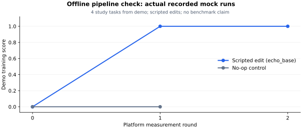

<p align="center">
  
</p>

<h1 align="center">HarnessGrad: Harness as a Continual Learner</h1>

<p align="center"><strong>A harness that improves is a learner, so what it <em>keeps</em> is measured as carefully as what it gains.</strong></p>

<p align="center">
  <a href="https://zjunlp.github.io/HarnessGrad-Hub/"></a>
  <a href="LICENSE"></a>
  
  
</p>

<p align="center">
  🌐 <a href="https://zjunlp.github.io/HarnessGrad-Hub/"><b>Website</b></a> ·
  🚀 <a href="https://zjunlp.github.io/HarnessGrad-Hub/getting-started/"><b>Quickstart</b></a> ·
  📊 <a href="https://huggingface.co/datasets/Xubqpanda/HarnessGrad"><b>Data</b></a> ·
  📜 <a href="INTERFACE.md"><b>Contract</b></a>
</p>

---

HarnessGrad measures harness self-improvement round by round instead of a single before/after delta: the platform owns the tasks, the sandbox, the scoring and the record, and a **method** is an external program that returns a candidate harness which the platform then measures itself.

The unit is a **plasticity/stability pair** — what a round gains, and what it silently breaks — written as a curve another method can be compared against. We do not propose improvement methods; we build the instrument that decides whether one worked.

## 🚀 Start here

| What you want to do | Start with |
| --- | --- |
| Run an RSI baseline on a harder reasoning benchmark | **BBEH × DGM**, the small real experiment below |
| Improve a terminal or coding harness | **Terminal-Bench 2** or **SWE-bench Pro V2** [recipes](docs/rsi-experiments.md) |
| Improve a research/search agent | **DeepSearchQA** [recipe](docs/rsi-experiments.md), with explicit search and judge services |
| Measure your own Python, Bash or agent CLI | [Five-minute harness entry](docs/bring-your-own-harness.md#five-minute-entry) |
| Run your own optimizer against the same tasks and harness | [Minimal external method](docs/bring-your-own-method.md) |

The platform uses Python's standard library. A solver harness, benchmark scorer,
search provider or Docker task can have additional dependencies; each recipe names
those prerequisites. Registered adapters are not a claim that all datasets are
installed or ready on your machine.

### 1. Install and check an empty machine

Use **Linux**, Python 3.10+, Git and a working `bubblewrap` namespace. Put the
virtual environment outside the checkout and `/tmp`, so the sandbox can mount its
runtime without exposing private platform or task files.

```bash
git clone https://github.com/zjunlp/HarnessGrad.git
cd HarnessGrad
python3 -m venv ~/.venvs/harnessgrad
source ~/.venvs/harnessgrad/bin/activate
python3 -m pip install -e .
./install.sh --check
HG_AGENT_BACKEND=mock harnessgrad run --config experiments/quickstart.json --check-only
```

```
check     req  result  detail
python    yes  ok      python 3.12.4
git       yes  ok      git version 2.34.1
bwrap     yes  ok      /usr/bin/bwrap: namespace builds (bubblewrap 0.6.1)
dataset   yes  ok      gsm8k: 8792 tasks
harness   yes  ok      <checkout>/base_harness/loop (cli, entrypoint agent.py, env_kinds files, exec)
writable  yes  ok      runs root: runs can be created; work root: ../harnessgrad_work exists and is writable
disk      no   ok      .: 93.1 GB free (a run needs about 5 GB)
ready: every required check passed
```

*(trimmed: the `harness` row names your checkout's absolute path and the free-space figure is
this machine's. `--prepare-only` instead creates the run directory and its redacted
`run_meta.json` and launches nothing; both flags read the same arguments the real run will read,
so the answer is about that invocation.)*

If system prerequisites are missing, `./install.sh` installs them and verifies the
boundary. The first check uses the repository's eight-task **demo fixture**; it
needs no downloaded benchmark, model, API key or Docker image. A failed required
check exits nonzero. Use WSL2 or a Linux host for other operating systems; native
macOS/Windows do not provide bubblewrap.

### 2. See a complete run without a model

```bash
HG_AGENT_BACKEND=mock harnessgrad run --config experiments/quickstart.json \
  --set run_id=demo-edit --improver none --fail-on-incomplete
HG_AGENT_BACKEND=mock harnessgrad run --config experiments/quickstart.json \
  --set method=noop --set run_id=demo-control --improver none --fail-on-incomplete
python3 tools/run_summary.py runs/demo-edit
python3 tools/plot_curve.py runs/demo-control runs/demo-edit
```

`echo_base` makes a fixed, scripted edit; `noop` deliberately stops with no edit.
These are interface controls, **not RSI benchmark results**. `HG_AGENT_BACKEND=mock`
is scoped to each command, so it does not leave your next real experiment in mock
mode. Repeat with fresh run IDs.



The [source receipt](.github/assets/demo-curve.json) and
[renderer](tools/render_demo_figure.py) reproduce this figure from recorded runs. Figure regeneration optionally needs
`matplotlib`; the experiment runner does not.

### 3. A real RSI smoke: BBEH × DGM

BBEH is a harder reasoning suite released in 2025. It is the light first experiment:
no task images, search service or judge model. DGM edits the harness's code using
study traces; HarnessGrad measures each candidate. This is the documented DGM
**port**, with its [fidelity differences](methods/dgm/method.json).

Prepare the complete pinned source, then freeze a custom study/held-out partition:

```bash
python3 -m pip install -r base_harness/loop/requirements.txt huggingface_hub
export HG_DATA_BBEH="$HOME/.local/share/harnessgrad/datasets/bbeh"
python3 -m data.scaffolds.native_qa.prepare --dataset bbeh --root "$HG_DATA_BBEH" --duplicate-questions exclude
harnessgrad split create --dataset bbeh --source official-eval \
  --train-ratio 0.2 --seed 42 --output splits/bbeh.json
```

The pinned file has 4520 source rows. Explicit `exclude` removes all 9 rows in
two repeated-question groups (including contradictory labels), leaving 4511
experiment tasks. The complete source hashes and exclusion counts/IDs remain in the
source manifest; this filtered custom pool is not the full benchmark.

Configure the two model roles explicitly. Replace the model names with ones your
servers actually serve. Local servers use a nonempty placeholder key; hosted
credentials belong in your environment and never in experiment JSON.

```bash
export HG_AGENT_BACKEND=openai
export HG_AGENT_BASE_URL=http://127.0.0.1:8001/v1
export HG_AGENT_MODEL=your-served-solver-model
export HG_AGENT_API_KEY=local
export HG_METHOD_BASE_URL=http://127.0.0.1:8001/v1
export HG_METHOD_MODEL=your-served-editor-model
export HG_METHOD_API_KEY=local

harnessgrad run --config experiments/rsi-bbeh.json --improver none --check-only --check-net
harnessgrad run --config experiments/rsi-bbeh.json --improver none
harnessgrad run --config experiments/rsi-bbeh-eval.json --improver none
python3 tools/run_summary.py runs/bbeh-dgm-study
python3 tools/run_summary.py runs/bbeh-dgm-heldout
python3 tools/results_matrix.py --runs runs/bbeh-dgm-heldout \
  --side eval --md bbeh-results.md --json bbeh-results.json
```

The recipe measures **five study tasks per round**, one improvement round and one
fixed checkpoint on **five held-out tasks**. This is a bounded smoke, not a full
BBEH score or evidence from enough tasks/trials for a paper. All methods should
reuse the same frozen split and measured task IDs. The split seed fixes partition
membership; the recorded sampling policy and concrete task IDs define each run's
measurement subset. BBEH's official evaluation material is being repartitioned
explicitly, so outputs identify the result as **custom held-out**.

A completion summary distinguishes `COMPLETE`, a valid `EARLY_STOP`, and
`INCOMPLETE`. The strict recipe exits nonzero on method or measurement failure;
an H0-only failure is not a completed RSI experiment. `--check-only` checks local
model/method prerequisites before H0; `--check-net` additionally checks required
model endpoints with GET requests, without generating tokens. Selected ordinary
judge/environment channels are checked too when the benchmark declares them.

For a larger study, choose the task count and trials deliberately, freeze the
protocol across baselines, and use all held-out tasks when reporting the full
custom partition. A higher score is not promised.

### Choose a research workload

| Benchmark | Why it is interesting for RSI/harness work | Preparation boundary |
| --- | --- | --- |
| **BBEH (2025)** | Hard reasoning; prompt/control/code changes with a local deterministic scorer | Pinned small source; solver and editor models |
| **Terminal-Bench 2** | Persistent terminal tasks; tools, long-context control and recovery | Docker and task images; prepare only selected tasks first |
| **SWE-bench Pro V2** | Recent long-horizon repository repair; V2 release on 2026-09-22 | Per-task images, trusted patch export and independent native regrade |
| **DeepSearchQA** | Multi-step web research and answer coverage | Search/fetch service plus an independent declared judge |

The [research recipes](docs/rsi-experiments.md) give source references, preparation,
train/checkpoint-eval commands and known limits. The full adapter catalogue is
[DATASETS.md](DATASETS.md); official metrics and protocol deviations are recorded
there. Existing GSM8K support remains available as a legacy small QA option.

### What you get

Each run keeps `curve.jsonl`, `run_meta.json`, saved harness states, per-task traces
and verdicts, diffs and `end-summary.md/json`. The summary shows completion,
baseline/final scores, cost coverage and invalid/unmeasured tasks. The matrix
exports a Markdown/JSON table and lists incomplete runs separately instead of
presenting their H0 as final results. [Result-reading walkthrough](docs/rsi-experiments.md#6-from-a-smoke-pair-to-a-research-result).

You can [supply your own split](docs/custom-dataset-splits.md),
[bring a harness](docs/bring-your-own-harness.md) or
[bring a method](docs/bring-your-own-method.md). Each uses the same driver and
measurement record.

Want your own study/held-out partition, including one carved from an official
validation or test pool? Run `harnessgrad split create --dataset math500
--train-ratio 0.2 --seed 42 --output splits/math500.json`, then pass that same file
with `--split splits/math500.json` (or the experiment's `split` field) to both
runs. [Custom split guide](docs/custom-dataset-splits.md) covers counts, groups,
source provenance and a zero-cost example.

<a id="dataset-storage"></a>

## Dataset storage

Set `HG_DATA_ROOT` in `.env` to choose the shared directory for external datasets:

```dotenv
HG_DATA_ROOT=/path/to/datasets
```

For example, GSM8K uses `<HG_DATA_ROOT>/gsm8k` and KUMO uses
`<HG_DATA_ROOT>/kumo`. A single-dataset override such as `HG_DATA_KUMO` takes
precedence. Existing directory names are preserved: CostBench's two adapters share
`costbench`, and StrongREJECT uses `strongreject/native-v1` by default.

Per-dataset variables use `HG_DATA_` followed by the full directory name in uppercase,
with runs of separators replaced by `_`: `tau2-bench` uses `HG_DATA_TAU2_BENCH` and
`strongreject/native-v1` uses `HG_DATA_STRONGREJECT_NATIVE_V1`. Retired names such as
`HG_KUMO_DATA` are no longer read; rename existing shell or `.env` settings.
Independent prepared/runtime overrides follow the same prefix:
`HG_DATA_MEMORYAGENTBENCH_PREPARED`, `HG_DATA_COSTBENCH_RUNTIME`, and
`HG_DATA_TAU3_BENCH_RUNTIME`.

Environment variables override `.env` for the same key. Linked worktrees inherit
the main checkout's `.env`; a worktree-local `.env` overrides that file. Relative
paths are anchored to the main checkout, regardless of the current terminal directory.
There is no implicit directory. Configure `HG_DATA_ROOT` before accessing external
data, or set the dataset's explicit override. Missing configuration produces an
instruction to set the path; listing datasets and generating documentation still work.
Keep `.env` local to each server; `.env.example` is the committed template.

Downloads, preparation tools and adapters share this resolver. Explicit preparation
arguments such as `--root`, `--raw` and `--output` still override their defaults.
`python3 tools/datasets.py --check --dataset kumo` reports the resolved absolute root.
`DOWNLOADS.md` shows logical locations such as `<HG_DATA_ROOT>/kumo/upstream`,
derived from each adapter's directory and each download's destination. Its per-dataset
root override replaces the logical data-root prefix, preserving the download suffix.
Source resources shipped in the repository continue to use repository-relative paths.
Sealed native-runtime manifests remain independently pinned to their reviewed host
and software; relocating dataset storage does not regenerate those manifests.

## 🧪 Test

```bash
python3 tools/run_tests.py                  # every lane: parallel plus exclusive
python3 tools/run_tests.py --dataset gsm8k  # that dataset plus the core platform tests
```

`--basetemp` must be **outside** the platform tree, and the runner enforces it.

## 📚 Documentation

| | |
| --- | --- |
| 📜 [`INTERFACE.md`](INTERFACE.md) | the measurement contract: what a harness may declare, what the platform guarantees |
| 🗺️ [`docs/architecture.md`](docs/architecture.md) | repository map and dependency direction |
| 🧭 [`docs/design-notes.md`](docs/design-notes.md) | why it is shaped this way, and what building it caught |
| 🛠️ [`docs/writing_a_harness.md`](docs/writing_a_harness.md) · [`docs/dataset-onboarding.md`](docs/dataset-onboarding.md) | contributing a harness, adding a dataset |
| 🚪 [`docs/bring-your-own-harness.md`](docs/bring-your-own-harness.md) | the on-ramp for an outside harness: a directory with an `agent.py` → a point on a measured curve, every command verified |
| 🧪 [`docs/test-suite.md`](docs/test-suite.md) | test lanes and the `--basetemp` rule |
| 🧭 [`docs/rsi-experiments.md`](docs/rsi-experiments.md) | runnable RSI recipes beyond arithmetic QA: BBEH, Terminal-Bench 2, DeepSearchQA and SWE-bench Pro V2 |
| 🤖 [`AGENTS.md`](AGENTS.md) | operating rules, including the staged-pilot policy |

## ⚠️ Status and limits

The mount namespace constrains the filesystem and nothing else: a harness keeps the network and the agent's API key, so egress filtering is still open (`INTERFACE.md` §4.8).

* 🚫 `--no-sandbox` is a debugging decision, never an automatic fallback; runs with and without it are not comparable, and `tools/plot_curve.py` refuses to mix them.
* 🔬 Contamination is not detectable from inside the framework — whether the agent model has already seen the benchmark is the largest threat to any curve this produces.
* 📋 Per-dataset enforcement gaps are tracked, not hidden, in [`registry/dataset-blockers.json`](registry/dataset-blockers.json); such a gap is not an ordinary zero score.

## 📄 License

MIT — see [`LICENSE`](LICENSE).
