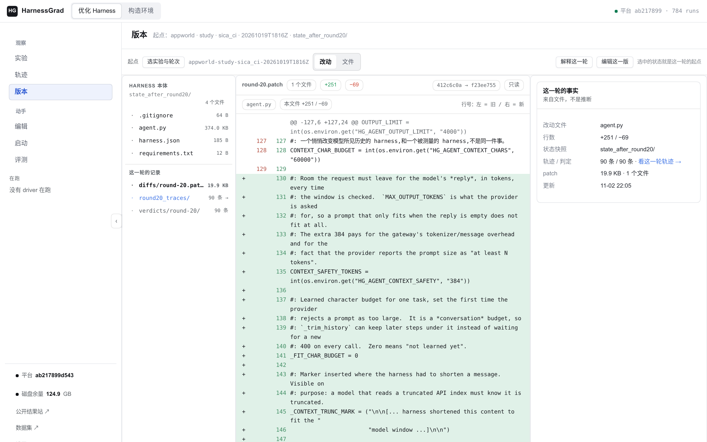
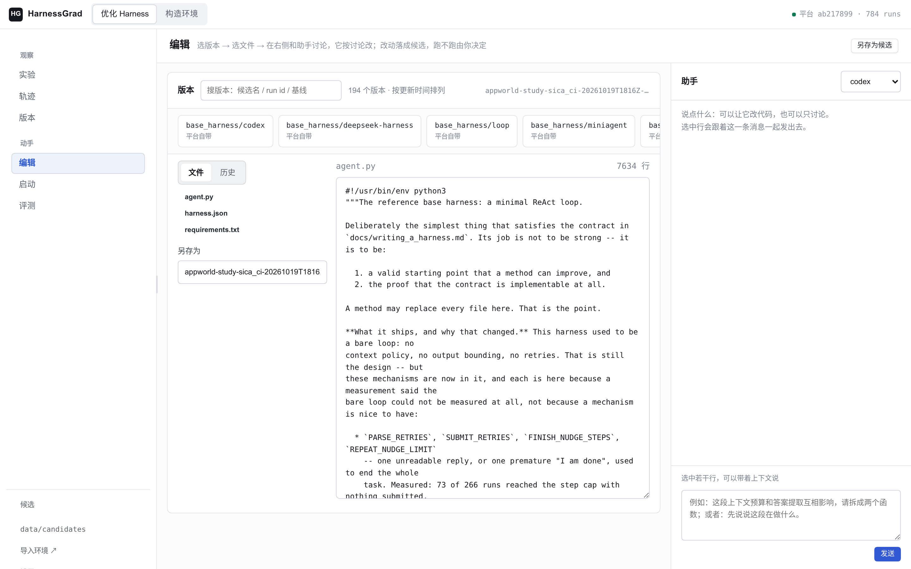
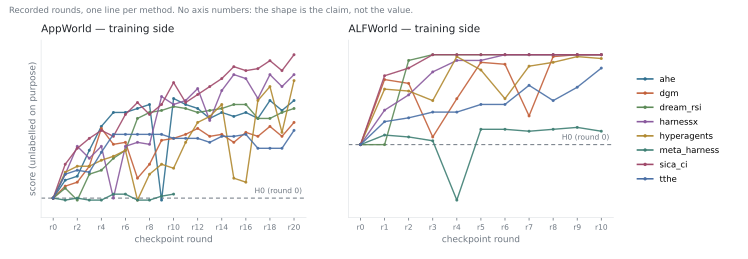

<p align="center">
  
</p>

<h1 align="center">HarnessGrad: Harness As a Continual Learner</h1>

<p align="center"><strong>A harness that improves is a learner, so what it <em>keeps</em> is measured as carefully as what it gains.</strong></p>

<p align="center">
  <a href="https://zjunlp.github.io/HarnessGrad-Hub/"></a>
  <a href="LICENSE"></a>
  
  
  <a href="https://github.com/zjunlp/HarnessGrad/actions/workflows/quality.yml"></a>
</p>

## What you can run

A run is one point in a **harness × method × benchmark** space: a *harness* solves tasks, a
*method* proposes edits to that harness between rounds, and a *benchmark* scores each
candidate. HarnessGrad supplies the three middle layers that every RSI paper re-implements
badly — tasks and scoring, an isolated sandbox, and version control over the candidate
harness — so an experiment is one command and a curve.

| axis | what ships | where |
| --- | --- | --- |
| **harnesses** | 8: `loop`, `codex`, `opencode`, `deepseek-harness`, `openclaw`, `miniagent`, `miniswe`, `oracle` | `base_harness/<name>/` |
| **RSI methods** | 19: `dgm`, `rrsi`, `adas`, `ahe`, `ace`, `skillopt`, `evoprompt`, `evo_harness`, `opro`, `tthe`, `dream_rsi`, `sica_ci`, `gepa`, `darwinx`, `arbor`, `hyperagents`, `meta_harness`, `harnessx`, `modular_rsi` | `experiments/method-<name>.json` |
| **benchmarks** | 56 declared, **55 runnable**, 1 refused (†) — every one listed: `agentdojo`, `aime`, `alfworld`, `api_bank` †, `appworld`, `authored_example_fix_bug`, `bbeh`, `bfcl_v3`, `bird_minidev`, `browsecomp`, `chessbench_puzzles`, `cooperbench`, `costbench`, `costbench_dynamic`, `deepsearchqa`, `deepswe`, `ds1000`, `fever`, `gaia`, `gsm8k`, `harvey_lab`, `hle`, `hotpotqa`, `jericho`, `jobbench`, `kumo`, `livecodebench`, `livemathbench`, `locomo`, `math`, `math500`, `memoryagentbench`, `musique`, `nestful` †, `nq`, `officeqa_pro`, `personamem_v2`, `physicsquestions`, `reasoning_gym`, `scienceworld`, `searchqa`, `sotuqa` †, `sportsunderstanding`, `spreadsheetbench`, `spreadsheetbench2`, `strategyqa`, `strongreject`, `supergpqa`, `swe_bench`, `swe_bench_pro`, `tau2_bench` †, `tau3_bench`, `tau_bench`, `terminal_bench`, `travelplanner`, `triviaqa`, `twowikimultihopqa`, `widesearch`, `workbench` | `data/datasets/`, detail in [`DATASETS.md`](DATASETS.md) |

Shipped experiments, each with a documented cost and prerequisites:

| experiment | harness | method | benchmark | cost |
| --- | --- | --- | --- | --- |
| first real run | `loop` | `dgm` | gsm8k, 5 tasks | minutes, no images |
| reasoning | `loop` | `dgm` | [BBEH × DGM](docs/rsi-experiments.md) | one provisioned dataset |
| terminal work | `miniswe` / `codex` | any | Terminal-Bench 2 | per-task container images |
| repository edits | `loop` | any | SWE-bench Pro V2 | per-task container images |
| research/search | `loop` | any | DeepSearchQA | search + judge services |

### Where to start, if you already have something

| you have | what we ask for | start here |
| --- | --- | --- |
| a harness (any language, any framework) | a directory with `harness.json` and an entrypoint that answers `--task` / `--workdir` | [bring-your-own-harness.md](docs/bring-your-own-harness.md) |
| an optimizer that edits files | a program that reads a trajectory and writes a candidate tree | [bring-your-own-method.md](docs/bring-your-own-method.md) |
| a benchmark and its official scorer | an adapter that materialises a task and runs *your* scorer | [dataset onboarding](docs/dataset-onboarding.md) |
| a paper you want to reproduce | nothing yet: pick the recipe and read its cost | [rsi-experiments.md](docs/rsi-experiments.md) |

**56 benchmarks** are declared, and the registry knows how to obtain each one. One is
declared but not yet measurable, and the † marks it. `api_bank`, `nestful` and
`sotuqa` were removed from the repository on 2026-11-03: each needed an artefact this project
cannot produce — the dialogue state those recorded API replies depend on (the gold call
reproduces its own recorded reply on 262 of 508 samples), a release whose official Win Rate
reproduces itself (the pinned scorer returned 1857/4 then 1854/7 on the same gold sequences),
and a judge model that has not been retired (its `acc` resolved to `text-davinci-003`) — so
keeping them as refusals could only restate that. Their reasons stay in
[`docs/refusal-policy.md`](docs/refusal-policy.md) for anyone reading an older receipt.

`tau2_bench` is the one that remains: its exclusion was lifted, its two missing facilities
ship in this repository (`tau3_bench/lib/runtime.py` runs the official user simulator,
`eval/service/judge.py` the judge), and what is missing is a v0.1.0 pin and a split — τ² tasks
below 1.0.1 are not comparable with results at or above it, so mixing revisions would produce a
number neither paper supports. Its `load()` still raises, and the receipt's `identity` is where
the missing piece has to appear when it stops.

Every one is recorded with its reason in
[`registry/dataset-blockers.json`](registry/dataset-blockers.json), and the reasoning for the
four is in [`docs/refusal-policy.md`](docs/refusal-policy.md).

## Why one command is enough

A harness is a directory with a `harness.json` and an entrypoint that answers
`--task <task.json> --workdir <dir>`; the *task*, not the harness, owns where the answer goes.
That is the whole contract ([`INTERFACE.md`](INTERFACE.md)). Everything a paper would
otherwise write itself is a platform responsibility:

- **tasks and scoring** — a dataset adapter materialises the task and runs the official
  scorer, so a score is the benchmark's number, not ours;
- **isolation** — `files` tasks run under `bubblewrap`, `exec` tasks in Docker, both with a
  declared allowlist, no network unless the dataset declares it, and a resource budget;
- **the candidate's history** — every round is a git commit in a workspace, which is what the
  next section is about;
- **the record** — one run directory with the metadata, the curve and the receipts.

Because the method only ever proposes a *tree*, it does not need to know the benchmark: the
same `experiments/method-dgm.json` runs on gsm8k, BBEH and Terminal-Bench.

## Why the comparison is fair

Three decisions make two curves comparable, and they are the reason to use this instead of a
folder of patches.

1. **Harnesses are versioned with git, one commit per round.** `harness_sha` is the tree hash
   of the candidate the score was measured on, so "which harness produced this number" is a
   commit, and the diff between two rows of a curve is `diffs/round-N.patch`. A snapshot
   (`snapshots/round-N.json`) carries the id and its parent, which is why a run can be
   recovered after a crash instead of being retyped.
2. **The task and method models are separate roles.** A method's edits are proposals, not
   measurements: swapping the solver model changes the number and swapping the editor model
   changes the proposals, and the receipt records both.
3. **A refusal is not a zero.** `COMPLETE`, `EARLY_STOP` (the method declined) and
   `INCOMPLETE` (the measurement failed) are different outcomes; only the last one is a
   failure of the instrument, and it is the only one that makes `--fail-on-incomplete` exit
   nonzero. A dataset that cannot be measured here is refused, never replaced by a proxy under
   the benchmark's own name ([`docs/refusal-policy.md`](docs/refusal-policy.md)).

## Installation

Linux with Python **3.12+**, git, and a working `bubblewrap`. Keep the virtual environment
outside the checkout and outside `/tmp`, so the sandbox can mount its runtime without exposing
your platform or task files.

```bash
git clone https://github.com/zjunlp/HarnessGrad.git
cd HarnessGrad
python3 -m venv ~/.venvs/harnessgrad
source ~/.venvs/harnessgrad/bin/activate
python3 -m pip install -e .
./install.sh --check
```

The platform itself has **no third-party runtime dependencies** and imports only the standard
library; a dataset, a harness or a search provider may need more, and each recipe names what.
`./install.sh` installs missing system prerequisites and verifies the sandbox boundary.

```bash
HG_AGENT_BACKEND=mock harnessgrad run --config experiments/quickstart.json --check-only
```

```
check            req  result  detail
python           yes  ok      python 3.12.4
git              yes  ok      git version 2.34.1
bwrap            yes  ok      /usr/bin/bwrap: namespace builds (bubblewrap 0.6.1)
dataset          yes  ok      demo: 8 tasks (test fixture, not a published dataset)
harness          yes  ok      <checkout>/base_harness/loop (cli, entrypoint agent.py, env_kinds files, exec)
writable         yes  ok      runs root: runs can be created; work root: ../harnessgrad_work exists and is writable
disk             no   ok      .: 93.1 GB free (a run needs about 5 GB)
ready: every required check passed
```

`--check-only` reads the same arguments the real run will read and launches nothing, so its
answer is about that invocation. `--prepare-only` goes one step further and writes the run
directory without starting a round.

### What each task environment needs

A dataset declares one `env_kind`, and that decides what the machine must provide.

| `env_kind` | what runs the task | what you need | typical datasets |
| --- | --- | --- | --- |
| `files` | `bubblewrap` namespace: the task's files plus a read-only runtime | Linux + `bubblewrap` (WSL2 works; native macOS/Windows do not) | gsm8k, bbeh, hotpotqa, most QA |
| `exec` | Docker container built from the task's image | a running Docker daemon and the images | appworld, alfworld, terminal-bench, swe-bench, tau-bench |

A harness declares which kinds it supports in `harness.json`; the platform refuses a pairing
the harness cannot run instead of silently degrading it. Nothing here pulls an image or a
dataset on its own: `tools/datasets.py --fetch` and the dataset's own prepare step are explicit.

<a id="dataset-storage"></a>

## Dataset storage

Set `HG_DATA_ROOT` in `.env` to choose the shared directory for external datasets:

```dotenv
HG_DATA_ROOT=/path/to/datasets
```

For example, GSM8K uses `<HG_DATA_ROOT>/gsm8k` and KUMO uses
`<HG_DATA_ROOT>/kumo`. A single-dataset override such as `HG_DATA_KUMO` takes
precedence. Existing directory names are preserved: CostBench's two adapters share
`costbench`, and StrongREJECT uses `strongreject/native-v1` by default.

Per-dataset variables use `HG_DATA_` followed by the full directory name in uppercase,
with runs of separators replaced by `_`: `tau2-bench` uses `HG_DATA_TAU2_BENCH` and
`strongreject/native-v1` uses `HG_DATA_STRONGREJECT_NATIVE_V1`. Retired names such as
`HG_KUMO_DATA` are no longer read; rename existing shell or `.env` settings.
Independent prepared/runtime overrides follow the same prefix:
`HG_DATA_MEMORYAGENTBENCH_PREPARED`, `HG_DATA_COSTBENCH_RUNTIME`, and
`HG_DATA_TAU3_BENCH_RUNTIME`.

Environment variables override `.env` for the same key. Linked worktrees inherit
the main checkout's `.env`; a worktree-local `.env` overrides that file. Relative
paths are anchored to the main checkout, regardless of the current terminal directory.
There is no implicit directory. Configure `HG_DATA_ROOT` before accessing external
data, or set the dataset's explicit override. Missing configuration produces an
instruction to set the path; listing datasets and generating documentation still work.
Keep `.env` local to each server; `.env.example` is the committed template.

Downloads, preparation tools and adapters share this resolver. Explicit preparation
arguments such as `--root`, `--raw` and `--output` still override their defaults.
`python3 tools/datasets.py --check --dataset kumo` reports the resolved absolute root.
`DOWNLOADS.md` shows logical locations such as `<HG_DATA_ROOT>/kumo/upstream`,
derived from each adapter's directory and each download's destination. Its per-dataset
root override replaces the logical data-root prefix, preserving the download suffix.
Source resources shipped in the repository continue to use repository-relative paths.
Sealed native-runtime manifests remain independently pinned to their reviewed host
and software; relocating dataset storage does not regenerate those manifests.

## Quick start: one real experiment

The fastest genuinely measured run is **gsm8k × `loop` × `dgm`**: 5 tasks, no container image,
no judge service.

```bash
export HG_DATA_ROOT="$HOME/harnessgrad-datasets"
python3 tools/datasets.py --fetch --dataset gsm8k
```

Point the two model roles at any OpenAI-compatible server. Local servers take a nonempty
placeholder key; hosted credentials belong in your environment, never in an experiment file.

```bash
export HG_AGENT_BACKEND=openai
export HG_AGENT_BASE_URL=http://127.0.0.1:8001/v1
export HG_AGENT_MODEL=your-served-solver-model
export HG_AGENT_API_KEY=local
export HG_METHOD_BASE_URL=http://127.0.0.1:8001/v1
export HG_METHOD_MODEL=your-served-editor-model
export HG_METHOD_API_KEY=local
```

```bash
harnessgrad run --config experiments/method-dgm.json --check-only --check-net   # ~5 s, no generation
harnessgrad run --config experiments/method-dgm.json                            # one round
python3 tools/run_summary.py runs/dgm-quickstart
```

The summary ends with the round table — score, coverage, and the `harness_sha` of the candidate
that each row was measured on:

```
round  score  coverage          kind      harness_sha
    0  0.400  [2/5]             platform  c9a1de0f3b21
    1  0.600  [3/5]             accepted  41f7b28c9d05
```

**Without a model** (no endpoint, no GPU, ~1 minute): the demo fixture runs the whole pipeline
with a scripted edit, and a `noop` control that declines to edit.

```bash
HG_AGENT_BACKEND=mock harnessgrad run --config experiments/quickstart.json \
  --set run_id=demo-edit --improver none --fail-on-incomplete
HG_AGENT_BACKEND=mock harnessgrad run --config experiments/quickstart.json \
  --set method=noop --set run_id=demo-control --improver none --fail-on-incomplete
python3 tools/plot_curve.py runs/demo-control runs/demo-edit
```

These two are interface controls, **not** benchmark results; `HG_AGENT_BACKEND=mock` is scoped
to its own command and does not leave your next real run in mock mode. What a run writes:

```
runs/<run_id>/run_meta.json    redacted argv, hashes, endpoint binding
              curve.jsonl      one row per round: score, coverage, harness_sha
              diffs/           round-N.patch, the accepted edit as a patch
              snapshots/       round-N.json: snapshot id + parent
              roundN_traces/   the trajectories the round scored
              end-summary.md   the human-readable result
```

Harnesses I did not write enter the system in five minutes
([`docs/bring-your-own-harness.md`](docs/bring-your-own-harness.md)); an optimizer that already
exists enters through a minimal external method
([`docs/bring-your-own-method.md`](docs/bring-your-own-method.md)).

## Contributors

One record: [`registry/leaderboards.json`](registry/leaderboards.json) — every harness, method,
benchmark, platform piece and measured result, each with its contributor and the month it was
adopted. `python3 tools/contributors.py --write` draws the graph, the totals and
[the page listing every entry per person](docs/contributors.md); `--check` fails when the
drawing and the record disagree.

Three growth curves, one per board, because a single chart merged three kinds of work into one
row of totals. Each is cumulative over a fixed 92-day window, so the shape is the history — a
flat segment means nothing landed that day — and a point's tooltip names the entries it
counted. A person with no entry on a board has no line there rather than a flat zero.

The dates are adoption dates: the catalogue was recorded in one pass on 2026-11-03, so the
benchmark curve is steep at the end. It becomes a history as contributions arrive. The bar for a credit is that the thing runs — see
[docs/leaderboards.md](docs/leaderboards.md), and `tools/contribute.py` for the three commands
that add one.

<!-- BEGIN contributors (generated by tools/contributors.py --write) -->


One calendar per board: a column per day over a fixed 92-day window, a row per contributor, and a cell whose tooltip names what landed that day. A row of zeroes is information — this person has not contributed to this board yet — so every row is kept. The right-hand column repeats the total. [Every entry, per person](docs/contributors.md) is a list; [The interactive page](https://zjunlp.github.io/HarnessGrad/contributors.html) is the same record with a draggable window and hover tooltips — it is published from `docs/contributors.html`, and the [website](https://zjunlp.github.io/HarnessGrad-Hub/contributors/) carries the same record.

| # | contributor | contributed |
| --- | --- | --- |
| 1 | [@Xubqpanda](https://github.com/Xubqpanda) | [66](docs/contributors.md#xubqpanda) |
| 2 | [@crepuscular-drizzle](https://github.com/crepuscular-drizzle) | [14](docs/contributors.md#crepuscular-drizzle) |
| 3 | [@trancefornow](https://github.com/trancefornow) | [11](docs/contributors.md#trancefornow) |

### Measured results

*No comparable result has been contributed yet. A result needs a benchmark+metric group, a receipt in this repository, and the tree hash the score was measured on — see [docs/leaderboards.md](docs/leaderboards.md).*
<!-- END contributors -->

## The workbench

The console is where a run becomes readable: the version bar lists every harness version and
every run, the left column is the round list, the middle is that round's edit as a diff, and the
right is the assistant that can argue with it. Both frames are a real console over the recorded
run `appworld-study-sica_ci-20261019T1816Z`, not a mock-up — and they are regenerated, not
cropped:





```bash
python3 console/uat/readme_screenshots.py --url http://127.0.0.1:4484 \
  --run appworld-study-sica_ci-20261019T1816Z --round 20 --out .github/assets
```

What the left column is made of is the point of the platform: each row is a git commit in the
run's workspace, so a diff is the accepted edit and `harness_sha` names the candidate the score
was measured on. Nothing here is reconstructed after the fact.

## What the curves look like



Two benchmarks we run ourselves, one line per method, from the recorded rounds in
[`.github/assets/trends.json`](.github/assets/trends.json). **The vertical axis carries no
ticks on purpose.** The figure answers one question — did the curve move while the method
edited the harness — and a number read off it would be quoted without the harness tree hash,
the task set and the scorer identity that make a score comparable. The receipt carries those
identifiers for every line, and `python3 tools/render_trends.py --check` keeps the drawing
equal to the receipt.

One line per method, and the rule for which methods appear is stated rather than chosen by
score: the seven whose checkpoints the site publishes, plus whatever the archive has a full
run for — `ahe` is absent from the ALFWorld panel because its run there stops at round 4.
`meta_harness` is in the archive and not drawn, because the site publishes no checkpoint for
it; dropping a method for scoring low would be selective reporting, which this is not.

Held-out scores, per-benchmark tables and every recorded run are on the
[website](https://zjunlp.github.io/HarnessGrad-Hub/), which is also where the full
leaderboards live.

The admission rule for the results board is in [`docs/leaderboards.md`](docs/leaderboards.md):
a benchmark+metric group, a receipt committed in this repository, and the tree hash the score
was measured on. Scores rank inside one group only — a BBEH accuracy and a Terminal-Bench pass
rate are not the same axis, and a table that mixes them invents a comparison.

## Documentation

| start here | |
| --- | --- |
| [`INTERFACE.md`](INTERFACE.md) | the harness contract, the task file, the receipt fields |
| [`docs/rsi-experiments.md`](docs/rsi-experiments.md) | the shipped recipes, with prerequisites and cost |
| [`DATASETS.md`](DATASETS.md) | every dataset, its source, metric and declared deviations |
| [`DOWNLOADS.md`](DOWNLOADS.md) | what each dataset needs and where it goes |
| [`docs/bring-your-own-harness.md`](docs/bring-your-own-harness.md) | admit a new harness |
| [`docs/bring-your-own-method.md`](docs/bring-your-own-method.md) | admit a new optimizer |
| [`docs/refusal-policy.md`](docs/refusal-policy.md) | what we refuse to measure, and why |
| [`docs/release-validation.md`](docs/release-validation.md) | what was verified for this release |

## Tests

```bash
python3 tools/run_tests.py --fast      # the suite a contributor runs
python3 tools/run_tests.py             # everything, including the measured-slow files
```

One pytest process per file, two lanes, a temporary root outside the checkout, and a run-alone
recheck of every failure, so a flake is reported as a flake ([`docs/test-lanes.md`](docs/test-lanes.md)).
CI runs the same entry point with `--fast`.

## Status and limits

Version 0.1 — the interface may still change, and every change that touches a recorded field is
called out in the release notes. The platform is the instrument, not a method: it contains no
new RSI algorithm, and the recipes are bounded integration smokes, not full benchmark
evaluations. A score produced here is only as comparable as the receipt that accompanies it.

## Citation

If the platform, the measurement protocol or a curve produced here is useful in your work:

```bibtex
@misc{xu2026harnessgrad,
  title  = {HarnessGrad: Harness As a Continual Learner},
  author = {Buqiang Xu and Yenan Wang and Yutong Yu and Rongyao Li and
            Jintian Zhang and Shuofei Qiao and Xuehai Wang and Zirui Xue and
            Yijun Chen and Ningyu Zhang},
  year   = {2026},
}
```

A result that depends on a specific recorded run should cite the run id as well: the receipt
names the harness tree hash the score was measured on, which is what makes the citation
re-derivable.

## License

MIT. Third-party benchmark code keeps its own licence and provenance next to the code that uses
it (`PROVENANCE.json`, `LICENSE.upstream`).
