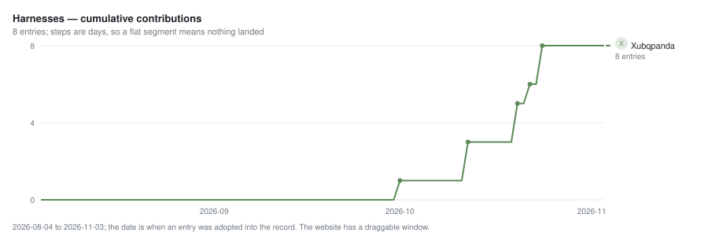
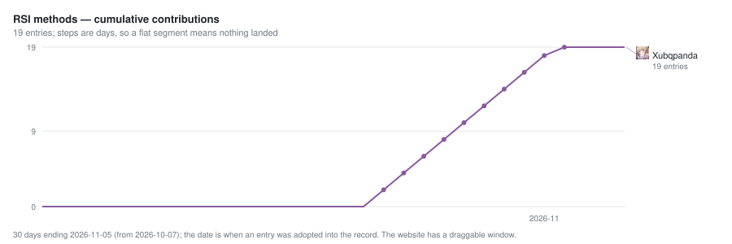
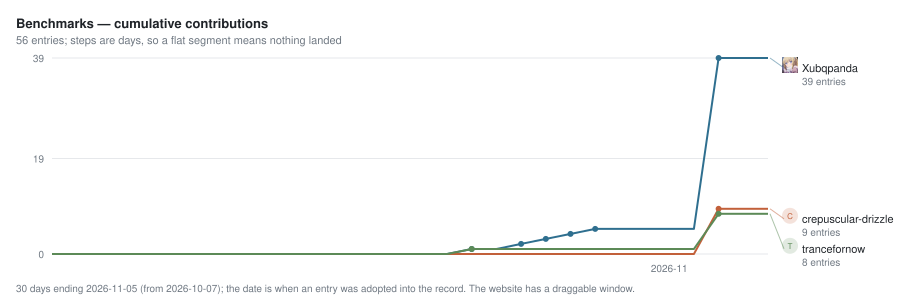
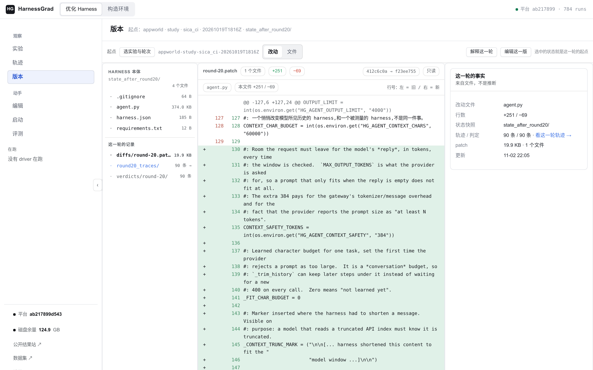
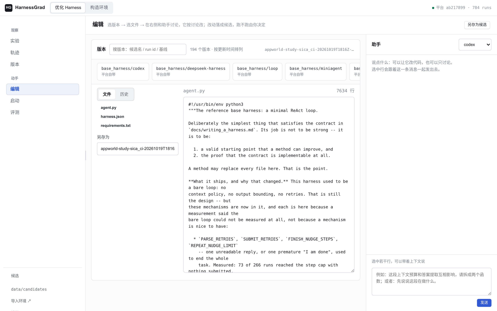
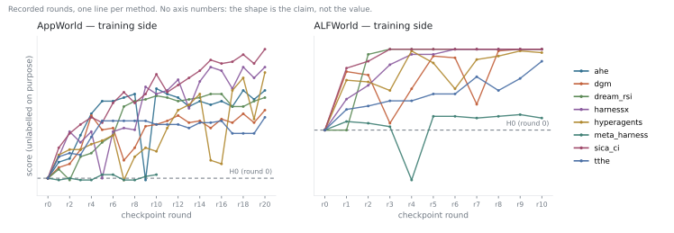

# README reference: contracts, storage and historical records

This page holds the detailed catalogue, storage rules and historical display notes moved
out of the onboarding README. Commands are run from the repository root. Dataset counts
and historical controls describe the recorded release, not a blanket readiness guarantee.

## What you can run

A run is a point in a **harness × method × benchmark** space: a harness solves tasks,
a method proposes edits between rounds, and a benchmark scores the candidate.

| axis | what ships | where |
| --- | --- | --- |
| **harnesses** | 8: `loop`, `codex`, `opencode`, `deepseek-harness`, `openclaw`, `miniagent`, `miniswe`, `oracle` | `base_harness/<name>/` |
| **RSI methods** | 19: `dgm`, `rrsi`, `adas`, `ahe`, `ace`, `skillopt`, `evoprompt`, `evo_harness`, `opro`, `tthe`, `dream_rsi`, `sica_ci`, `gepa`, `darwinx`, `arbor`, `hyperagents`, `meta_harness`, `harnessx`, `modular_rsi` | `experiments/method-<name>.json` |
| **benchmarks** | 56 declared, **56 runnable**, none refused — every one listed: `agentdojo`, `aime`, `alfworld`, `appworld`, `authored_example_fix_bug`, `bbeh`, `bfcl_v3`, `bird_minidev`, `browsecomp`, `chessbench_puzzles`, `cooperbench`, `costbench`, `costbench_dynamic`, `deepsearchqa`, `deepswe`, `ds1000`, `fever`, `gaia`, `gsm8k`, `harvey_lab`, `hle`, `hotpotqa`, `jericho`, `jobbench`, `kumo`, `livecodebench`, `livemathbench`, `locomo`, `math`, `math500`, `memoryagentbench`, `musique`, `nq`, `officeqa_pro`, `personamem_v2`, `physicsquestions`, `reasoning_gym`, `scienceworld`, `searchqa`, `sportsunderstanding`, `spreadsheetbench`, `spreadsheetbench2`, `strategyqa`, `strongreject`, `supergpqa`, `swe_bench`, `swe_bench_pro`, `tau2_bench`, `tau3_bench`, `tau_bench`, `terminal_bench`, `travelplanner`, `triviaqa`, `twowikimultihopqa`, `widesearch`, `workbench` | `data/datasets/`, detail in [DATASETS.md](../DATASETS.md) |

The registry knows how to obtain all declared datasets; running a particular pairing
still needs its data, runtime, services and supported harness environment kind.

### Where to start, if you already have something

- A harness: [bring your own harness](bring-your-own-harness.md).
- An optimizer that edits files: [bring your own method](bring-your-own-method.md).
- A benchmark and official scorer: [dataset onboarding](dataset-onboarding.md).
- A paper recipe: [RSI experiments](rsi-experiments.md), including prerequisites and cost.

`tau2_bench` was the last refusal, lifted on 2026-11-04: v0.1.0, 278 tasks,
the release's own user simulator in a private trusted process, and its own
`EvaluationType.ALL` scorer. Three released tasks (one per domain) measured oracle
1.0 / do-nothing 0.0. Its metric is `tau2.v0.1.0.ALL.binary`, **not comparable**
with any `tau3.*` metric. Upstream states that results below 1.0.1 are not
comparable with those at or above it.

`api_bank`, `nestful` and `sotuqa` were removed on 2026-11-03. Their missing
artifacts were respectively the dialogue state behind recorded API replies
(the gold call reproduced its recorded reply on 262/508 samples), a release
whose official Win Rate reproduces itself (the pinned scorer returned 1857/4
then 1854/7 on the same gold sequences), and a non-retired judge (`acc` resolved
to `text-davinci-003`). These are historical explanations, not substitute scores.
See [blocker states](../registry/dataset-blockers.json) and
[refusal policy](refusal-policy.md) for the per-dataset exits and older receipts.

## Why one command is enough

A harness directory declares `harness.json` and an entrypoint accepting
`--task <task.json> --workdir <dir>`; the task owns the answer destination.
[INTERFACE.md](../INTERFACE.md) defines the full contract.

The platform owns task materialisation and scoring, isolation, candidate history,
and the run record. `files` tasks use bubblewrap; `exec` tasks use Docker, with
allowlists, declared network capabilities and resource budgets. A method proposes
a candidate tree rather than implementing the benchmark adapter itself.

## Why the comparison is fair

These are requirements for interpreting records, not a guarantee that any two runs
are comparable:

1. Harnesses are versioned with git. `harness_sha` identifies the candidate tree;
   `diffs/round-N.patch` records changes and `snapshots/round-N.json` records the
   snapshot and parent used for recovery.
2. Solver and editor are separate roles. A different solver changes measurements;
   a different editor changes proposals. Receipts record both.
3. A refusal is not a zero. `COMPLETE`, `EARLY_STOP` (the method declined) and
   `INCOMPLETE` (measurement failed) are distinct. `--fail-on-incomplete` makes
   incomplete outcomes nonzero. An unmeasurable benchmark is refused, not replaced
   with a proxy under its name.

### What each task environment needs

| `env_kind` | task runtime | prerequisites | examples |
| --- | --- | --- | --- |
| `files` | bubblewrap namespace with task files and read-only runtime | Linux + working bubblewrap (WSL2 works; native macOS/Windows do not) | gsm8k, bbeh, hotpotqa |
| `exec` | Docker container from task image | running Docker daemon and required images | appworld, alfworld, terminal-bench, swe-bench, tau-bench |

The harness declares supported kinds in `harness.json`; unsupported pairings are
refused. Fetching data and preparing images/runtimes are explicit steps, not implicit
side effects of starting a run.

## Dataset storage

Set `HG_DATA_ROOT` in `.env` to choose shared external dataset storage:

```dotenv
HG_DATA_ROOT=/path/to/datasets
```

GSM8K uses `<HG_DATA_ROOT>/gsm8k` and KUMO uses `<HG_DATA_ROOT>/kumo`.
A single-dataset override such as `HG_DATA_KUMO` takes precedence. Existing names
are preserved: the CostBench adapters share `costbench`; StrongREJECT defaults
to `strongreject/native-v1`.

Per-dataset variables use `HG_DATA_` plus the full directory name in uppercase,
with runs of separators replaced by `_`: `tau2-bench` uses `HG_DATA_TAU2_BENCH`;
`strongreject/native-v1` uses `HG_DATA_STRONGREJECT_NATIVE_V1`. Retired names such
as `HG_KUMO_DATA` are no longer read. Prepared/runtime overrides include
`HG_DATA_MEMORYAGENTBENCH_PREPARED`, `HG_DATA_COSTBENCH_RUNTIME` and
`HG_DATA_TAU3_BENCH_RUNTIME`.

Environment variables override `.env` for the same key. Linked worktrees inherit
the main checkout's `.env`; a worktree-local `.env` overrides it. Relative paths
are anchored to the main checkout regardless of the terminal directory. There
is no implicit data directory: configure the root or an explicit override before
accessing external data. Listing datasets and generating docs still work without
one. Keep `.env` server-local; [the template](../.env.example) is committed.

Downloads, preparation tools and adapters share this resolver. Explicit `--root`,
`--raw` and `--output` arguments still override defaults.

```bash
python3 tools/datasets.py --check --dataset kumo
```

This reports the resolved absolute root. [DOWNLOADS.md](../DOWNLOADS.md) uses
logical locations such as `<HG_DATA_ROOT>/kumo/upstream`; an override replaces
the logical root prefix but preserves the download suffix. Repository source
resources remain repository-relative. Sealed native-runtime manifests are pinned
to their reviewed host/software; moving data does not regenerate them.

## Run records

A run directory contains `run_meta.json` (redacted arguments, hashes and endpoint
binding), `curve.jsonl` (round score and coverage), `diffs/`, `snapshots/`,
`roundN_traces/` and `end-summary.md`. Inspect these with
`python3 tools/run_summary.py runs/<run_id>` rather than quoting a score alone.
The old README's illustrative 0.400 → 0.600 table was not an experiment receipt;
it is intentionally not an expected outcome of the onboarding recipe.

## Contributors

[registry/leaderboards.json](../registry/leaderboards.json) records credited
harnesses, methods, benchmarks, platform pieces and measured results.
`python3 tools/contributors.py --write` regenerates the block below, the figures
and [per-person details](contributors.md); `--check` detects drift.

There are three cumulative growth curves over a fixed 92-day window, not a
single total merging three kinds of work. Tooltips name entries counted; people
without entries on a board have no line. Dates are adoption dates: the catalogue
was recorded in one pass on 2026-11-03, explaining its steep end. Admission
requires runnable work; see [leaderboards](leaderboards.md) and `tools/contribute.py`.

<!-- BEGIN contributors (generated by tools/contributors.py --write) -->






One calendar per board: a column per day over a fixed 92-day window, a row per contributor, and a cell whose tooltip names what landed that day. A row of zeroes is information — this person has not contributed to this board yet — so every row is kept. The right-hand column repeats the total. [Every entry, per person](../docs/contributors.md) is a list; [The interactive page](https://zjunlp.github.io/HarnessGrad/contributors.html) is the same record with a draggable window and hover tooltips — it is published from `docs/contributors.html`, and the [website](https://zjunlp.github.io/HarnessGrad-Hub/contributors/) carries the same record.

| # | contributor | contributed |
| --- | --- | --- |
| 1 | [@Xubqpanda](https://github.com/Xubqpanda) | [66](../docs/contributors.md#xubqpanda) |
| 2 | [@crepuscular-drizzle](https://github.com/crepuscular-drizzle) | [14](../docs/contributors.md#crepuscular-drizzle) |
| 3 | [@trancefornow](https://github.com/trancefornow) | [11](../docs/contributors.md#trancefornow) |

### Measured results

*No comparable result has been contributed yet. A result needs a benchmark+metric group, a receipt in this repository, and the tree hash the score was measured on — see [docs/leaderboards.md](../docs/leaderboards.md).*
<!-- END contributors -->

## The workbench

The console displays recorded runs, harness versions, rounds, their diffs and an
assistant. These frames come from the recorded run
`appworld-study-sica_ci-20261019T1816Z`, not a mock-up:





```bash
python3 console/uat/readme_screenshots.py --url http://127.0.0.1:4484 \
  --run appworld-study-sica_ci-20261019T1816Z --round 20 --out .github/assets
```

Each row corresponds to a git commit in the workspace; the diff and `harness_sha`
identify the candidate measured, not a reconstruction after the fact.

## What the curves look like



The figure comes from [trends.json](../.github/assets/trends.json). It deliberately
has no vertical ticks: it shows whether recorded curves moved, not a standalone
comparable score. Task sets, scorer identity and candidate hashes belong with
any numeric comparison. `python3 tools/render_trends.py --check` checks the drawing
against the record.

The inclusion rule is the seven methods whose checkpoints the site publishes,
plus methods with full archived runs. `ahe` is absent from ALFWorld because its
run stops at round 4; `meta_harness` is archived but not drawn because the site
publishes no checkpoint for it. This historical selection rule is not a quality
ranking. The [website](https://zjunlp.github.io/HarnessGrad-Hub/) carries recorded
runs, held-out tables and leaderboards. Results-board admission requires a
benchmark+metric group, a committed receipt and the measured tree hash; scores
rank only within a group. BBEH accuracy and Terminal-Bench pass rate are not one axis.
